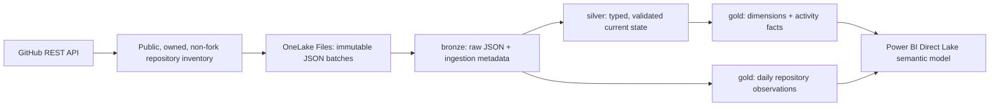

# GitHub activity analytics in Microsoft Fabric

A working project for turning an owner's public, non-fork GitHub repositories into
Power BI-ready data. One Fabric workspace contains one **schema-enabled**
lakehouse, discovery and GitHub API ingestion notebooks, three transformation
notebooks, a semantic-model refresh notebook, a Fabric Data Factory pipeline,
and a Direct Lake semantic model.



## Data assets

| Layer | Tables | Grain and behavior |
|---|---|---|
| Bronze | `repository_registry` | One row per discovered repository ID; preserves first/last seen times and marks no-longer-eligible repositories inactive |
| Bronze | `github_raw`, `ingestion_batches` | Original response objects and completed batch manifests; append-only with idempotent batch keys |
| Silver | `repositories`, `commits`, `issues`, `pull_requests`, `completed_batch` | Typed current state, incrementally upserted on repository-scoped natural keys, plus a completion gate |
| Gold | `dim_repository`, `dim_actor`, `dim_date` | Conformed repository, GitHub login, contiguous UTC date dimensions |
| Gold | `fact_commits`, `fact_issues`, `fact_pull_requests` | One row per commit, issue, or pull request |
| Gold | `fact_repository_daily` | Last observed stars/forks per repository per UTC day |

`silver.quality_rejects` is created only if invalid source records are encountered;
the run fails visibly rather than silently dropping them. Gold checks uniqueness,
referential integrity, source reconciliation, and persisted row counts.

The source is every **public, non-fork repository owned by `roberts-andy`**, including
archived repositories. Repositories merely collaborated on, private repositories,
and forks are excluded. GitHub does not expose a reliable original-creator field:
the operational definition is current ownership plus `fork = false`.
The inventory drives repository metadata, default-branch commits, issues, and
pull requests. Initial loads include full history; subsequent runs fetch changes.
Commit keys include repository ID, because even
non-fork repositories can share commit SHAs. Issues and PR numbers are likewise
scoped to their repository. The issues endpoint also returns PRs; Silver separates
them to avoid double counting. Empty repositories and empty issue/PR sources are valid.

## Run the project

Deployment prerequisites: Python 3.10+, Azure CLI signed in to the Fabric tenant,
and an active Fabric capacity. GitHub CLI is needed only for the optional local
`stage` fallback. After deployment, refresh runs entirely in Fabric, without a
local computer or CLI session. No credentials or tenant-specific deployment IDs
are stored in the repository.

```powershell
python -m pip install -r requirements-dev.txt
az login
az rest --method get --resource https://api.fabric.microsoft.com --url https://api.fabric.microsoft.com/v1/capacities --headers x-ms-fabric-skill=e2e-medallion-architecture
python scripts\project.py provision --capacity-id <active-fabric-capacity-id>
python scripts\project.py bootstrap
python scripts\project.py deploy
python scripts\project.py discover
python scripts\project.py run --notebook 00_ingest_github
python scripts\project.py run
python scripts\project.py model
python scripts\project.py deploy --notebook 04_refresh_semantic_model
python scripts\refresh.py deploy
```

Edit `config.json` before provisioning another environment. Deployment IDs, job IDs,
and notebook packages are stored locally under ignored `.local`. `bootstrap` creates
the medallion schemas through Livy and releases the session. `deploy` validates
Jupyter structure and binds all notebooks to the lakehouse before uploading.

### Refresh entirely in Fabric

Open the **GitHub Analytics Refresh** pipeline in the workspace and select **Run**.
It executes these activities, each only after the previous activity succeeds:

`00_discover_repositories` -> `00_ingest_github` -> `01_bronze` ->
`02_silver` -> `03_gold` -> `04_refresh_semantic_model`.

The ingestion notebook makes ordinary Python HTTPS requests on the notebook
driver, follows GitHub pagination, rechecks repository eligibility, and writes
`Files/github/<batch_id>/records.jsonl` and `manifest.json` to the attached
lakehouse. It publishes `Files/github/latest.json` only after complete extraction
and file closure. Partial batches never replace the completed pointer.
The existing Bronze contract and local `stage` fallback remain compatible.
The first native run establishes checkpoints with a full load. Subsequent runs
fetch changes while retaining earlier activity in Silver and Bronze.

The final notebook uses the Fabric run identity's Power BI token to refresh/frame
the **existing** semantic model and waits for completion. It does not redeploy the
model or report. Request IDs and completion status are persisted under
`Files/github/model_refreshes`. Only after the model refresh completes does it
promote the batch's proposed extraction checkpoints to `Files/github/checkpoint.json`.
Any earlier failure leaves the successful checkpoint unchanged, so the next run
replays the outstanding interval rather than skipping it. The run identity needs permission to execute all
notebooks, write the lakehouse, and refresh the semantic model. Refresh credential
failures must be corrected in Power BI Service; the pipeline never changes access.

Pipeline concurrency is one; activities do not automatically retry mutations.
Do not run individual discovery/ingestion/layer notebooks or local staging while
the pipeline is active. The pipeline is manually runnable and schedulable in
Fabric, but **no recurring schedule is configured**. Set a cadence/time zone in
Fabric only after reviewing authentication and capacity availability.

The optional local command only starts/monitors the cloud pipeline:

```powershell
python scripts\refresh.py run
python scripts\refresh.py verify
```

If monitoring is interrupted, the run ID remains in `.local\deployment.json`;
check Fabric Monitoring or rerun `refresh.py run` while it is active to resume
monitoring without submitting another job.

### Incremental refresh semantics

The default `github_ingestion.load_mode` is `incremental`. Running twice a day
normally fetches about twelve hours of changes, **since the last successful run**,
not a hardcoded trailing twelve-hour slice. A failed or delayed run catches up
from the saved checkpoint.

- Issues use GitHub's `since` filter on **updated** time with a five-minute overlap,
  so older issues that close or reopen are included. The same change feed identifies
  updated PRs, whose complete details are fetched individually; the extractor does
  not redownload every PR.
- Commits use the saved default-branch head SHA and GitHub's paginated comparison
  API, rather than filtering on author dates. This includes newly pushed commits
  with old dates. Unchanged heads require no commit-history download.
- Every run refreshes repository metadata for daily stars/forks observations.
  New repositories and changed default branches bootstrap fully. A detected
  rewritten/diverged commit history triggers a full commit reconciliation for
  that repository.
- Silver Delta merges insert/update changed records, retain untouched history,
  remove no-longer-eligible repositories, and remove missing records only for
  explicitly full-reconciled repository/entity pairs. Overlap/replay is idempotent.
  Rows retain their last source batch; `completed_batch` certifies the whole snapshot.
  Gold still rebuilds its small complete reporting tables, and Direct Lake is
  reframed; neither is reduced to just the latest twelve hours.

GitHub does not provide issue/PR deletion tombstones through this change feed.
Periodically reconcile all source state by setting `github_ingestion.load_mode`
to `full`, redeploying `00_ingest_github`, and running the pipeline once. Restore
`incremental` and redeploy afterward. Alternatively, override the ingestion
notebook's `load_mode` parameter for a manual notebook run, then execute the
downstream layers and model refresh sequentially. Do not mix individual runs
with an active pipeline.

### GitHub authentication

The public-only prototype defaults to explicit `anonymous` mode. This requires
no token, but GitHub typically allows only **60 requests/hour per outbound IP**;
Fabric egress can be shared. Growing inventories or repeated runs can exceed that
limit. Errors fail visibly and retain the previous completed landing batch.
The extractor reuses one owner listing for metadata to reduce API requests and
never silently switches from authenticated to anonymous access.

For reliable recurring operation, store a read-only GitHub token in an existing
Azure Key Vault, and set only these non-secret references in `config.json`:

```json
"github_ingestion": {
  "load_mode": "incremental",
  "auth_mode": "key_vault",
  "key_vault_url": "https://<vault-name>.vault.azure.net/",
  "secret_name": "<github-token-secret-name>"
}
```

Give the Fabric run identity secret-read access through your normal approval
process. Redeploy `00_ingest_github` with
`python scripts\project.py deploy --notebook 00_ingest_github`.
It retrieves the token with `notebookutils.credentials.getSecret` at runtime.
Never put the token in configuration, notebook parameters, output, or source.
No token is copied from the local GitHub CLI, and no vault, secret, or access grant
is provisioned by this project. Discovery remains a low-volume anonymous public
inventory scan, even when activity ingestion uses a Key Vault token.

### Rescan repositories from Fabric

Execute **`00_discover_repositories`** in the Fabric workspace to rescan the public
repository list, add new eligible repositories to `bronze.repository_registry`,
preserve their first-seen timestamps, update renamed repositories by stable GitHub
ID, and deactivate entries no longer returned by the public non-fork owner scan.
Its `owner` parameter defaults to the owner in `config.json`.

The notebook follows every public API page and only publishes the inventory after
a complete successful scan. It uses anonymous HTTPS for this public metadata scan
(normally a few requests; GitHub's anonymous limit is typically 60/hour).
Rate-limit or API errors fail visibly and retain the previous published inventory.
Private repositories are never enumerated through the authenticated `/user/repos`
endpoint. This notebook discovers repositories; it does not fetch commit/issue
history or refresh the semantic model itself.

`python scripts\project.py discover` executes that same Fabric notebook remotely.
The optional legacy `stage` command reads its published OneLake inventory and uses the GitHub CLI's
existing OAuth session to fetch every activity API page for **each** eligible
repository. It rechecks visibility, ownership, and fork status before fetching.
It uploads to OneLake using the Azure CLI's Storage-audience token. The latest-batch pointer is
published only after every repository, endpoint, and file succeeds; aggregate and
per-repository manifest counts gate downstream processing. Spark reads landed files;
it never reads an arbitrary HTTPS URL as a Spark data source.

Local `stage` remains a **full snapshot** fallback, not an incremental extractor.
Discovery changes take effect at the next API-ingestion notebook (or local `stage`)
and layer run. The default `project.py run`
executes only Bronze, Silver, and Gold; discovery is an explicit separate operation
so it cannot change the inventory halfway through a batch.

Run discovery, staging, and transformations sequentially; concurrent refreshes are
not supported. An interrupted notebook run can be monitored by its saved job ID.
Do not blindly retry a job submission after a timeout.
To intentionally rerun only a failed layer after correcting it:

```powershell
python scripts\project.py run --notebook 02_silver --notebook 03_gold
```

## Modeling and dashboard semantics

The semantic model uses Gold-only Direct Lake entity partitions, single-direction
dimension-to-fact relationships, and explicit measures. Date filters apply to commit
author dates and issue/pull-request creation dates; they do not represent historical
backlog. Issue state is its current observed state. Merged pull requests are counted
within their creation-date cohort, not by merge date.

Stars and forks are **snapshots**, not additive event totals. Use latest-observed
measures; never sum daily snapshots across time. GitHub does not provide prior
stars/forks history through these endpoints, so history starts at the first capture.
Unlinked/deleted GitHub users use the `unlinked` member and are excluded from the
identified commit-author count. No issue, review, or delivery activity is fabricated.

## GitHub Team Activity report

`scripts\report.py` builds and deploys a three-page interactive Power BI report
using the existing semantic model; it does not change model measures.

| Page | Questions answered |
|---|---|
| Repository overview | Where is activity concentrated? How are commits and PR creation trending? How do repositories compare? |
| Pull request flow | What are the current outcomes of PR creation cohorts? Which PRs remain open? How long did merged PRs take? |
| Contribution patterns | Which GitHub accounts are contributing, and across which UTC weekdays? How are commits, issues and PR creation distributed? |

Repository, language, UTC date-range, and GitHub-account slicers synchronize across
pages. Clicking chart marks or table rows filters related visuals. The report
opens on all available history, excluding future calendar dates; use the date
slicer to focus on recent activity. Generated PBIR files are stored under ignored
`.local\report`; the reproducible source is `scripts\report.py`.

```powershell
python -m pip install -r requirements-dev.txt
python scripts\report.py build
python scripts\report.py deploy
python scripts\report.py verify
```

`build` validates the definition against Microsoft's public JSON schemas and needs
internet access to `developer.microsoft.com`. `deploy` creates **GitHub Team Activity**,
reads its definition back, and checks its semantic-model binding. It refuses to
overwrite an existing report unless `--replace` is supplied. Export any manual
report edits before using that flag. This is a multi-page report, not a separately
pinned Power BI Service dashboard.

`verify` validates the generated PBIR source and compares the published definition
and semantic-model binding without republishing. Definition validation does not
replace checking the rendered report in Power BI. The report includes an explicit
shared base theme, with custom-theme references matching the registered filename.

After `deploy` or `verify`, open `.local\report\definition-liveConnect.pbir` in
Power BI Desktop and sign in with the workspace account. This file uses the full
connection returned by the service; `definition.pbir` uses the shorter model-ID
reference intended for REST deployment.

The PBIR content version (`definition\version.json`: `2.0.0`) is distinct from the
report entry-point version (`definition.pbir`: `4.0`). The generator rejects a
content-version mix-up before deployment: JSON-schema validation alone accepts
`4.0.0`, but that value prevented report pages from loading in Desktop and the service.

**Interpretation:** commit counts are not productivity, quality, effort, or hours
worked. GitHub accounts can include bots and are not unique people. No GitHub team
membership, reviews, CI/CD runs, push events, or deployment outcomes are collected,
so this report cannot compare named teams or claim DORA metrics. Contribution
patterns exclude the `unlinked` member, but retain identified automation accounts.
PR merge rate and mean merge hours are current outcomes of the selected
**creation-date cohort**, not merge-date throughput or review-response time.
Blank cycle times mean no qualifying rows. The capture card shows the latest
snapshot within the selected dates; it is blank if those dates exclude all captures.

## Scope and operations

This is a small-estate proof of concept: native ingestion is checkpointed and
incremental after bootstrap, Bronze retains captures, Silver merges current
state, and Gold rebuilds small, unpartitioned reporting tables.
Full reconciliation handles source deletions; commit comparison detects branch
history rewrites. The extractor does not collect every branch,
comments, reviews, deleted commits, or historical issue/PR transitions.
Repositories that leave the eligible inventory are removed from the current Gold
model, including their repository snapshots; their raw capture history remains in Bronze.
For larger repositories, add deletion-reconciliation policies, partition-aware
Gold writes, and a separately approved refresh schedule.
No recurring schedule is enabled and no paid capacity is started automatically.

Raw public GitHub payloads can contain contributor profile details and commit emails.
They remain in the lakehouse; they are not checked into Git. Gold keeps only the
GitHub login required for author analysis. Restrict workspace access appropriately
and define retention before production use. Switching to private repositories
requires explicit review of GitHub permissions and the Fabric sharing boundary.

The semantic model was authored and validated using the Fabric semantic-model
authoring skill and Power BI modeling MCP. `semantic_model\model.bim` is its
exported TMSL snapshot, with deployment IDs and generated lineage metadata removed
and OneLake workspace/lakehouse tokens parameterized. The `model` command deploys
that source snapshot through the Fabric definition API; it will not overwrite an
existing model unless `--replace` is supplied. Replacement is deliberate and can
affect downstream report bindings. Use modeling tools for routine live edits.
The Fabric refresh pipeline frames the model automatically after Gold. When
running layers individually or deploying a model, refresh/frame it using
`04_refresh_semantic_model`, Power BI Service, or the modeling MCP.

Local checks:

```powershell
python -m unittest discover -s tests
```
