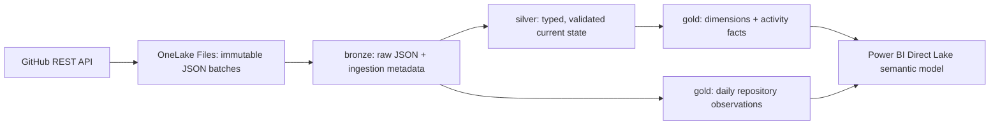

# GitHub activity analytics in Microsoft Fabric

A working project for turning this public repository's real GitHub activity into
Power BI-ready data. One Fabric workspace contains one **schema-enabled**
lakehouse, three transformation notebooks, and a Direct Lake semantic model.



## Data assets

| Layer | Tables | Grain and behavior |
|---|---|---|
| Bronze | `github_raw`, `ingestion_batches` | Original response objects and completed batch manifests; append-only with idempotent batch keys |
| Silver | `repositories`, `commits`, `issues`, `pull_requests`, `completed_batch` | Typed current source snapshot, deduplicated on natural keys, plus a completion gate |
| Gold | `dim_repository`, `dim_actor`, `dim_date` | Conformed repository, GitHub login, contiguous UTC date dimensions |
| Gold | `fact_commits`, `fact_issues`, `fact_pull_requests` | One row per commit, issue, or pull request |
| Gold | `fact_repository_daily` | Last observed stars/forks per repository per UTC day |

`silver.quality_rejects` is created only if invalid source records are encountered;
the run fails visibly rather than silently dropping them. Gold checks uniqueness,
referential integrity, source reconciliation, and persisted row counts.

The source is `roberts-andy/github-fabric-analytics`, including repository metadata,
all default-branch commits, all accessible issues, and all pull requests. The issues
endpoint also returns pull requests; Silver separates them to avoid double counting.
Empty issue/pull-request sources produce correctly typed empty tables, not sample rows.

## Run the project

Prerequisites: Python 3.10+, GitHub CLI signed in with access to the source repository,
Azure CLI signed in to the Fabric tenant, and an active Fabric capacity. No credentials
or tenant-specific deployment IDs are stored in the repository.

```powershell
python -m pip install -r requirements-dev.txt
az login
gh auth login
az rest --method get --resource https://api.fabric.microsoft.com --url https://api.fabric.microsoft.com/v1/capacities --headers x-ms-fabric-skill=e2e-medallion-architecture
python scripts\project.py provision --capacity-id <active-fabric-capacity-id>
python scripts\project.py bootstrap
python scripts\project.py deploy
python scripts\project.py stage
python scripts\project.py run
python scripts\project.py model
```

Edit `config.json` before provisioning another environment. Deployment IDs, job IDs,
and notebook packages are stored locally under ignored `.local`. `bootstrap` creates
the medallion schemas through Livy and releases the session. `deploy` validates
Jupyter structure and binds all notebooks to the lakehouse before uploading.

Subsequent data refreshes:

```powershell
python scripts\project.py stage
python scripts\project.py run
python scripts\project.py status
```

`stage` uses the GitHub CLI's existing OAuth session to fetch every API page. It uploads
to OneLake using the Azure CLI's Storage-audience token. The latest-batch pointer is
published only after every endpoint and file succeeds. Spark reads landed files;
it never reads an arbitrary HTTPS URL as a Spark data source.

Run stage and transformation commands sequentially; concurrent refreshes of this
single-repository project are not supported. An interrupted notebook run can be
monitored by its saved job ID. Do not blindly retry a job submission after a timeout.
To intentionally rerun only a failed layer after correcting it:

```powershell
python scripts\project.py run --notebook 02_silver --notebook 03_gold
```

## Modeling and dashboard semantics

The semantic model uses Gold-only Direct Lake entity partitions, single-direction
dimension-to-fact relationships, and explicit measures. Date filters apply to commit
author dates and issue/pull-request creation dates; they do not represent historical
backlog. Issue state is its current observed state. Merged pull requests are counted
within their creation-date cohort, not by merge date.

Stars and forks are **snapshots**, not additive event totals. Use latest-observed
measures; never sum daily snapshots across time. GitHub does not provide prior
stars/forks history through these endpoints, so history starts at the first capture.
Unlinked/deleted GitHub users use the `unlinked` member and are excluded from the
identified commit-author count. No issue, review, or delivery activity is fabricated.

Suggested report visuals: commit trend by Date, current issue state, pull-request
merge rate, average hours to merge, latest stars/forks, and source freshness. Report
visuals and a pinned Power BI dashboard are a separate step from this project's
initial four-stage data/model setup.

## Scope and operations

This is a small-repository proof of concept: each ingestion retrieves a full API
snapshot; Bronze retains history while Silver and Gold replace small, unpartitioned
current-state tables. This also handles source deletions and rebases correctly.
For larger repositories, add tested incremental watermarks, reconciliation of
deletions, partition-aware writes, and a separately approved refresh schedule.
No recurring schedule is enabled and no paid capacity is started automatically.

Raw public GitHub payloads can contain contributor profile details and commit emails.
They remain in the lakehouse; they are not checked into Git. Gold keeps only the
GitHub login required for author analysis. Restrict workspace access appropriately
and define retention before production use. Switching to private repositories
requires explicit review of GitHub permissions and the Fabric sharing boundary.

The semantic model was authored and validated using the Fabric semantic-model
authoring skill and Power BI modeling MCP. `semantic_model\model.bim` is its
exported TMSL snapshot, with deployment IDs and generated lineage metadata removed
and OneLake workspace/lakehouse tokens parameterized. The `model` command deploys
that source snapshot through the Fabric definition API; it will not overwrite an
existing model unless `--replace` is supplied. Replacement is deliberate and can
affect downstream report bindings. Use modeling tools for routine live edits.
After a data refresh or model deployment, refresh/frame the semantic model using
Power BI Service or the modeling MCP, and validate measures before sharing reports.

Local checks:

```powershell
python -m unittest discover -s tests
```
